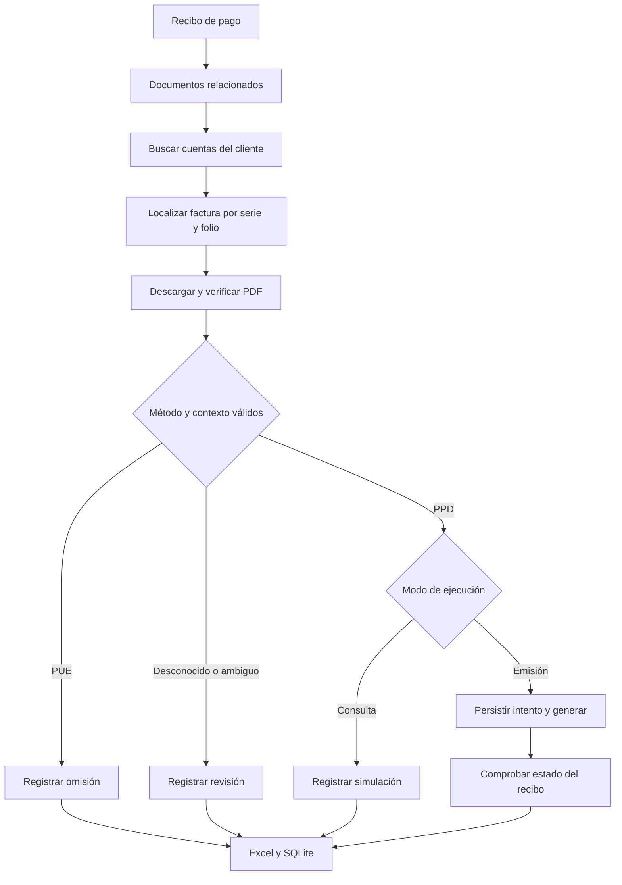

# CFDI Payment Automation

Automatización en Python que cruza recibos de pago, cuentas de clientes y facturas PDF de un ERP web para identificar el método de pago y registrar cada decisión. Combina reglas de negocio, calidad de datos, automatización de navegador y trazabilidad en Excel y SQLite.

**Proyecto de portafolio orientado a análisis de datos y mejora de procesos.** Surgió de un proceso operativo real y se desarrolló con asistencia de IA. La aportación del responsable del proyecto incluyó identificar el problema, traducirlo a reglas, supervisar pruebas, detectar excepciones y verificar los resultados.

Esta copia contiene datos de prueba ficticios. No incluye credenciales, archivos fiscales, capturas del sistema, bases de datos de clientes ni la dirección del ERP operativo. Los selectores corresponden a una integración específica con ASP.NET: no es un conector universal para cualquier ERP.

## El problema de negocio

Clasificar a un cliente como PUE o PPD en un catálogo no bastaba para decidir sobre una factura concreta. Además, un mismo nombre podía aparecer en varias cuentas y tener varios recibos consecutivos. La revisión requería cruzar módulos del ERP y consultar el PDF de cada factura.

El reto fue convertir ese procedimiento en reglas verificables: ¿qué documento corresponde al recibo?, ¿en qué cuenta está?, ¿qué método muestra su PDF? y ¿qué evidencia confirma el resultado de una acción?

## Qué hace

- Mantiene dos pestañas: pagos y facturación, con rangos de fecha independientes y fijos durante el recorrido.
- Busca la factura por serie y folio, conservando una comparación exacta aunque haya ceros de relleno.
- Si un nombre aparece en varias cuentas, consulta cada una para localizar la factura correspondiente.
- Descarga el PDF y comprueba método de pago, serie, folio y nombre del receptor.
- Omite PUE y clientes no encontrados. Deja ambigüedades y documentos no verificables en revisión.
- Valida todas las facturas de un recibo antes de permitir la generación del CFDI de pago.
- Conserva la regla operativa del caso original: saldo del recibo entre $0.00 y $1.00 para continuar.
- Registra resultados en Excel y persiste el intento de envío en SQLite antes del clic de generación.



## Resultados y alcance de la evidencia

En el entorno operativo de origen se completó una revisión de **72 recibos**. Después de una prueba individual de emisión, el responsable ejecutó el rango y reportó haber verificado los resultados satisfactoriamente.

Ese número describe recibos revisados, no 72 CFDI nuevos: hubo PUE, documentos ya timbrados y omisiones. No se midieron formalmente ahorro de tiempo, tasa de error comparativa ni retorno de inversión. Los registros operativos no se publican; la reproducción pública utiliza pruebas sintéticas.

## Metodología y aprendizaje

1. **Levantamiento del proceso:** descomponer el trabajo manual y definir la evidencia necesaria para cada decisión.
2. **Reglas de calidad:** usar la factura como fuente para PUE/PPD y distinguir cuentas duplicadas, clientes ausentes y documentos ambiguos.
3. **Prototipado incremental:** separar navegación, lectura de PDF, reglas y persistencia.
4. **Diagnóstico por evidencia:** añadir registros por etapa y reproducir fallos concretos, en lugar de aumentar tiempos de espera sin conocer el punto de bloqueo.
5. **Validación gradual:** tres recibos sin emitir, recorrido completo, casos específicos, una emisión real y ejecución del rango.
6. **Transferencia al usuario:** parametrizar fechas y modo de ejecución desde la terminal y documentar cómo interpretar los resultados.

Un aprendizaje concreto fue que volver a escribir el mismo cliente no produce necesariamente un evento de cambio. Otro fue que un indicador de actividad del ERP podía seguir activo después de descargar un PDF. Ambos casos llevaron a ajustar el orden de las acciones y crear pruebas de regresión.

Lee el [caso de estudio](docs/caso-de-estudio.md) para ver las decisiones y las competencias que respaldan.

## Tecnologías

| Componente | Uso |
|---|---|
| Python | Orquestación y reglas de negocio |
| Playwright | Navegación, selección y descarga de documentos |
| pypdf | Extracción de texto de PDFs |
| SQLite | Persistencia de resultados e intentos de emisión |
| openpyxl | Reporte de revisión en Excel |
| argparse y logging | Parámetros de ejecución y diagnóstico por etapa |
| unittest | Casos sintéticos y portal simulado |

La IA se utilizó durante el desarrollo y la depuración. El programa ejecutado utiliza reglas deterministas; no envía las facturas a un modelo de lenguaje.

## Probar sin acceso al ERP

Requisitos: Python 3.11 o superior y Chromium de Playwright.

```powershell
python -m venv .venv
.\.venv\Scripts\python.exe -m pip install -r requirements.txt
.\.venv\Scripts\python.exe -m playwright install chromium
.\.venv\Scripts\python.exe -m unittest test_cfdi_pdf -v
```

En Linux/macOS, utiliza `.venv/bin/python` en lugar de `.\.venv\Scripts\python.exe`. Las pruebas generan PDFs ficticios, simulan el portal y comprueban que las acciones de emisión no ocurran cuando faltan condiciones. No necesitan credenciales ni acceso al ERP.

## Configurar un entorno autorizado

1. Copia `.env.example` como `.env` y establece `ERP_URL`.
2. Revisa las rutas y selectores del adaptador para tu instancia de ERP.
3. Usa inicialmente `--login-manual` y el modo de consulta predeterminado.

```powershell
.\.venv\Scripts\python.exe generar_cfdi_por_pdf.py --pagos-desde 01/05/2026 --pagos-hasta 07/05/2026 --facturas-desde 01/04/2026 --facturas-hasta 31/05/2026 --sucursal SucursalDemo --limite 3 --login-manual
```

Los valores de este ejemplo son ficticios. Sin `--emitir`, el programa consulta y registra. Añadir `--emitir` habilita acciones reales en el ERP configurado. `--recibo` permite revisar un número exacto sin recorrer el resto de los recibos del rango.

## Estructura

```text
generar_cfdi_por_pdf.py   Navegador, configuración y recorrido
cfdi_pdf_core.py         Validación documental y bitácora
test_cfdi_pdf.py         Pruebas con datos sintéticos
requirements.txt        Dependencias de Python
docs/caso-de-estudio.md  Decisiones, evidencia y aprendizaje
```

Los resultados se generan localmente en `resultados_cfdi_pdf/`: Excel, PDFs, logs y `bitacora.sqlite3`. Esa carpeta se excluye de Git. No borres la bitácora de una operación en curso: registra los intentos de envío y bloquea reenvíos automáticos inciertos.

## Límites conocidos

- La interfaz del ERP puede cambiar y requerir adaptar selectores o eventos.
- Los PDFs escaneados, cifrados o con otro formato pueden requerir revisión; no se incorpora OCR.
- Un recibo con combinación PUE/PPD o documentos ambiguos queda en revisión.
- Si el resultado del envío es incierto, el programa no lo repite automáticamente: debe cotejarse en el ERP.
- La persistencia y la comprobación del estado reducen el riesgo de duplicación; no constituyen una garantía distribuida de entrega exactamente una vez.

## Referencias técnicas

- [Descargas en Playwright](https://playwright.dev/python/docs/downloads)
- [Extracción de texto en pypdf](https://pypdf.readthedocs.io/en/stable/user/extract-text.html)
- [Argumentos de línea de comandos en Python](https://docs.python.org/3/library/argparse.html)

## Autoría

Eduardo Liceaga Calderón — análisis del proceso, definición de reglas, supervisión operativa y validación de resultados; desarrollo e iteración asistidos por IA. La documentación distingue la evidencia del caso real de las pruebas públicas reproducibles.
